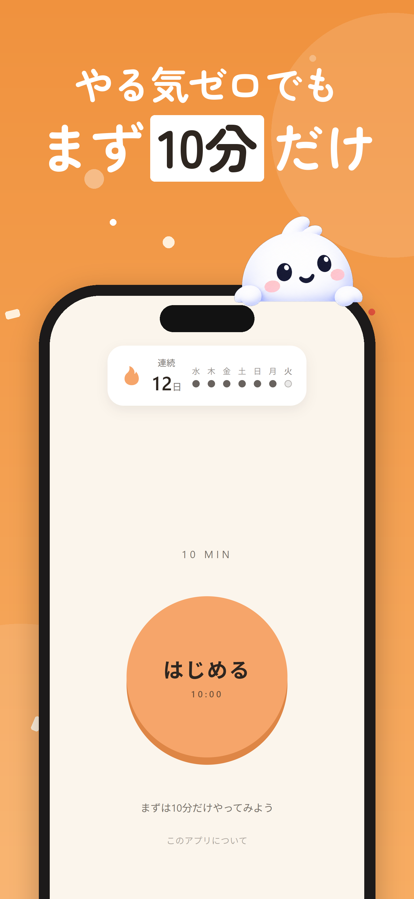
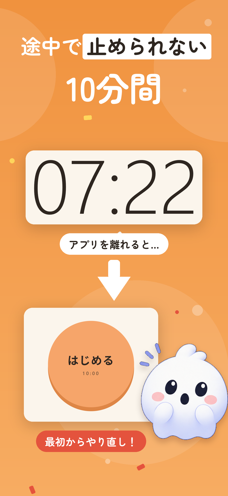
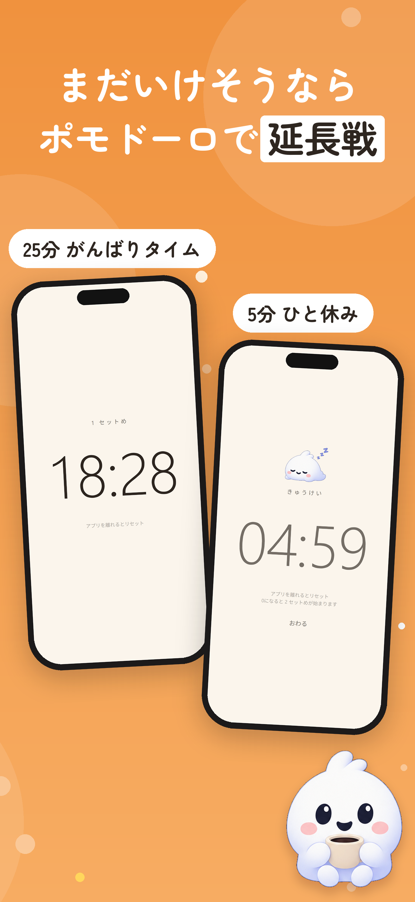
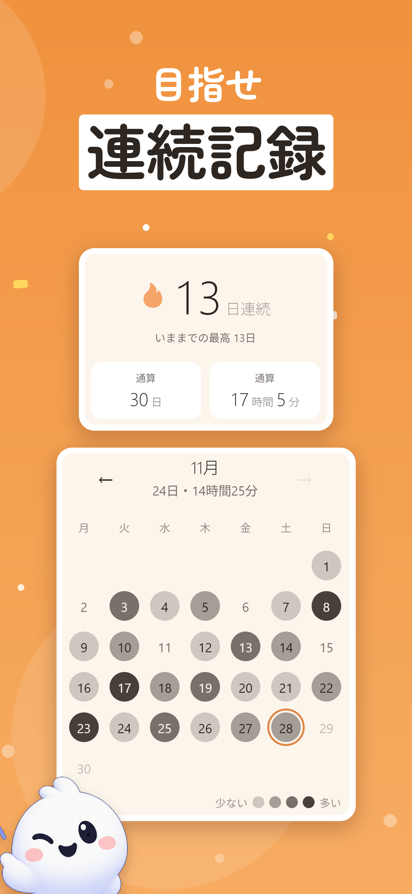

# いますぐ10分

10分だけ集中するための iOS アプリです。はじめるボタンを押したら、途中で止める方法はありません。
アプリを離れると最初からやり直しです。10分やりきったら、まだいけそうならポモドーロ（25分＋5分休憩）で続けられます。
やりきった日はカレンダーに記録されます。

<p>
  
  
  
  
  
</p>

## 動かし方

Expo（SDK 58）で作っています。

```sh
npm install
npx expo start
```

`assets/start.mp3`（はじめるボタンの音）はリポジトリに含まれていません。くらげ工匠
(http://www.kurage-kosho.info/) の「ボタン081」を落として、`assets/start.mp3` という名前で置いてください。
素材の再配布が禁止されているため、コミットしていません。詳しくは [AGENTS.md](AGENTS.md) を見てください。

## プライバシー

個人情報は集めません。記録は端末の中にだけ保存されます。[プライバシーポリシー](PRIVACY_POLICY.md)
